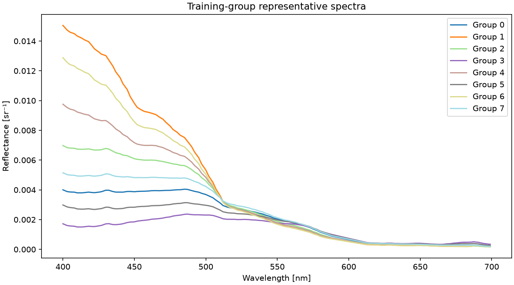
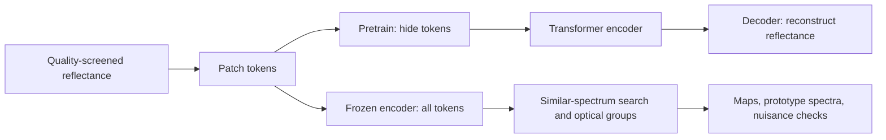

<div align="center">

# PACE ViT

**Learning ocean color across wavelengths**

Spectral and spatial vision transformers for NASA PACE OCI ocean-color data.

[Quick start](#quick-start) · [Architecture](#architecture) · [Results](#early-results) · [Documentation](#documentation)


<sub>AI-generated concept illustration. The waves represent spectral observations; this is not satellite imagery.</sub>

</div>

## Overview

PACE ViT studies what spectral and spatial patterns a model can learn from
NASA PACE Ocean Color Instrument (OCI) Level-2 reflectance cubes (`Rrs`).
The current goal is self-supervised discovery of optical water types and
phytoplankton-related spectral patterns. Training uses the cubes themselves;
chlorophyll and other biological labels are not training targets.

The [research assessment](docs/self_supervised_research.md) recommends a small
spectral-spatial masked autoencoder, followed by frozen features, similar-spectrum
search, and optical group maps. The [discovery experiment](docs/discovery_experiment.md)
implements this comparison. Its scientific value still needs a real multi-scene
run and independent observations.

The project provides:

- **AOP-only discovery:** grouped spectral-spatial masking, PCA and spectral
  autoencoder baselines, frozen features, group maps, and cross-scene retrieval.
- **Token designs:** single wavelengths, narrow wavelength groups, and
  full-spectrum spatial patches.
- **An earlier chlorophyll benchmark:** five model variants across three seeds, including
  a spectral MLP and the same spatial transformer with and without pretraining.
- **Data checks:** packed-value decoding, quality flags, scene alignment, and
  separation of training, validation, and test dates and regions.
- **Experiment tools:** checksum-verified downloads, saved metrics and weights,
  notebook execution, and Docker/Nautilus templates.

**Current milestone:** the 30-scene comparison is complete. PCA best recovers
missing wavelengths, and nearby-pixel interpolation best fills spatial holes.
The masked model needs better red-band fidelity before scaling. Biological
identity and EMIT-to-PACE transfer remain unvalidated.

A new [single-scene discovery pilot](docs/discovery_experiment.md#first-run-with-the-existing-download)
completed on Nautilus on 2026-11-20 using the existing Earthdata v3.2 file.
It compares PCA, a spectral autoencoder, and the grouped MAE on buffered spatial
splits. [Results](docs/discovery_pilot_results.md) show that PCA wins on spectral
gaps and interpolation wins on spatial holes. The MAE needs further evidence
before scaling. [The launch record](docs/discovery_pilot_run.json) records inputs and setup.

The [multi-scene campaign](docs/discovery_multiscene_run.md) adds 30 AOP v3.2
granules across seven regions, with separate dates and regions for training,
validation, and testing. All ten experiments and 45 pairwise comparisons
completed on Nautilus. See the [measured results](docs/discovery_multiscene_results.md)
and [machine-readable scores](docs/discovery_multiscene_results.json).



These are observed group-mean spectra. The eight groups were fixed as an
analysis setting; biological interpretation requires independent observations.

## Quick start

Use Python 3.11 or later and [uv](https://docs.astral.sh/uv/).
Run these commands from the repository root:

```sh
git clone https://github.com/sameeerkashyap/hyperspectral_pace_vit.git
cd hyperspectral_pace_vit
uv sync --extra discovery

# Download the two public teaching samples.
uv run python -m data.dataset_download.sample

# Inspect their fields and run the tests.
uv run python -m data.dataset_download.inspect data/raw/*.nc
uv run python -m unittest discover -s tests -v
```

To run one reconstruction experiment, including a verified input download:

```sh
uv run python -m src.runner --plan experiments/sample.json --index 0
```

This runs the first 500-step experiment. Omit `--index 0` to run all six
experiments in sequence. Results go to `outputs/`; the runner refuses to
replace an existing experiment directory. Use `--output-root outputs/new-run`
for a new run.

For a shorter check after downloading the samples:

```sh
uv run python -m src.experiment \
  --aop data/raw/PACE_OCI.20240730T181157.L2.OC_AOP.V2_0.NRT.nc \
  --steps 30 --chips 16 --threads 1 --output outputs/quick-check
```

## Architecture

A masked autoencoder learns to reconstruct hidden spectral and spatial patches.
The models expose encoder features. The discovery workflow
uses these features to find similar spectra and candidate optical water types.
It does not need a concentration prediction head.



| Design | Token content | Tokens for a 128 × 128 chip with 172 bands |
| --- | --- | ---: |
| `WavelengthAwareMAE` | One wavelength in a 4 × 4 spatial patch | 176,128 |
| `SpatialSpectralMAE` | All wavelengths in a 4 × 4 spatial patch | 1,024 |

The wavelength model uses physical wavelength positions and accepts different
band counts. The spatial model reduces the number of tokens, but uses a fixed
spectral grid and compresses the full spectrum at the input. Cross-sensor
transfer still needs spectral alignment and separate validation.

Spatial-model inputs have shape `[batch, bands, height, width]`.
The grouped spectral-spatial model uses BHWC inputs. Its default 16 × 16 chip,
2 × 2 spatial patches, and 8-band groups produce 1088 tokens for the inspected
136-band visible grid. See the [discovery guide](docs/discovery_experiment.md)
for the ten-run Nautilus plan and its AOP-only scene manifest.
See the [architecture guide](docs/architecture.md) for tensor shapes, defaults,
masking details, and a runnable model example.

## Early results

The saved pilot used **one real PACE scene, one seed, 30 CPU training steps,
and at most 16 chips per split**. It tested reconstruction on spatially held-out
chips, including wavelengths absent from training.

| Method | Seen-band RMSE ↓ | Unseen-band RMSE ↓ |
| --- | ---: | ---: |
| Wavelength positions | 0.001931 | 0.002049 |
| Band-index positions | 0.002042 | 0.002119 |
| Training-mean spectrum | 0.002340 | 0.002189 |
| Visible-band interpolation | 0.003291 | 0.003510 |

RMSE is root mean square error, in sr⁻¹. The wavelength model's unseen-band
error was about 3.3% lower than the band-index model's. This small pilot checks
the pipeline; it does not establish a reliable advantage or chlorophyll accuracy.
Residuals remain large relative to the reported measurement uncertainty.

[Experiment design and interpretation](docs/experiment_design.md) ·
[Saved metrics and split coordinates](docs/pilot_results.json)

## Data and validation

| Input | Contents | Use |
| --- | --- | --- |
| OCI L2 AOP | Reflectance (`Rrs`), uncertainty, optical fields | Model input and reconstruction |
| OCI L2 BGC | Chlorophyll-a (`chlor_a`), phytoplankton carbon (`carbon_phyto`) | Matched satellite-derived targets |
| Navigation and flags | Latitude, longitude, acquisition time, quality flags | Alignment and screening |

The public AOP example has **184 reflectance bands from 339–719 nm**.
Read `sensor_band_parameters/wavelength_3d` for the `Rrs` spectral axis;
the separate sensor-wide `wavelength` array does not match it.
The benchmark uses native bands between 400 and 700 nm.

> The teaching AOP and BGC files have different acquisition dates and processing
> versions. They cannot form a training pair or support reflectance–concentration
> correlation. Use current, matched research products for the benchmark.

The [download manifest](data/manifest.json) records sample URLs, sizes, and
SHA-256 hashes. Raw data, local environments, and run outputs stay out of Git.
NASA research downloads may require Earthdata credentials; keep credentials
outside the repository and container image.

To analyze a valid matched pair:

```sh
uv run python -m src.correlate path/to/AOP.nc path/to/BGC.nc \
  --output data/correlations.json
```

Satellite chlorophyll and carbon products are estimates from optical signals.
Independent field measurements are still needed to test biological accuracy.
The current predictors produce point estimates without calibrated uncertainty.

## Earlier chlorophyll benchmark

This supervised comparison remains available as implemented code. It is separate
from the current self-supervised discovery goal and is not required to train it.

The [main plan](experiments/chlorophyll.json) compares five variants across
three paired seeds:

| Variant | Training path |
| --- | --- |
| `mlp` | Spectral MLP baseline |
| `spectral` | Wavelength-token reconstruction, then supervised prediction |
| `spatial` | Full-spectrum spatial reconstruction, then supervised prediction |
| `mixed` | Wavelength tokens with spectral-span and spatial-patch masking |
| `spatial-scratch` | Same spatial predictor, trained without pretraining |

Provide matched AOP/BGC scenes using the
[scene-manifest example](experiments/chlorophyll-scenes.example.json).
The loader requires separate dates and non-overlapping regions across splits.
The plan has no dataset URLs because real matched inputs have not been supplied.

```sh
uv run python -m src.benchmark --scenes /path/to/scenes.json \
  --data-dir /path/to/netcdf --arm spatial --output outputs/chlorophyll-spatial
```

See the [benchmark guide](docs/chlorophyll_benchmark.md) for all 15 runs,
checkpoint selection, metrics, and the wider-model comparison. Docker and
Nautilus experiments use context `nautilus` and namespace `sea-meets-the-stars`.
Set the image, storage, and inputs before use. Follow the [runtime guide](docs/running_experiments.md).

## Documentation

| Guide | Contents |
| --- | --- |
| [Run self-supervised discovery](docs/discovery_experiment.md) | AOP scene splits, model controls, Nautilus launch, feature maps, and comparison outputs |
| [Self-supervised discovery research](docs/self_supervised_research.md) | Method comparison, evidence, proposed experiments, and limits on biological claims |
| [PACE fields and NRP data access](docs/data_access.md) | Used fields, preprocessing, AWS CLI, and S3 staging |
| [Architecture](docs/architecture.md) | Model interfaces, tensor shapes, diagrams, and examples |
| [Experiment design](docs/experiment_design.md) | Reconstruction controls, pilot results, and evidence limits |
| [Chlorophyll benchmark](docs/chlorophyll_benchmark.md) | Matched scenes, five variants, training, and evaluation |
| [Running experiments](docs/running_experiments.md) | Local runs, Docker, Nautilus, scripts, and notebooks |
| [Sample findings](docs/sample_findings.md) | Observed properties and limits of the teaching files |
| [Field inventory](docs/fields.md) | NetCDF fields, dimensions, and units |
| [Wavelength transfer](docs/wavelength_transfer.md) | EMIT/PACE differences and proposed transfer tests |

```text
src/             Models, data checks, training, and experiment runners
tests/           Model, runner, and generated NetCDF fixture tests
experiments/     Run plans, scene-manifest example, and training notebook
data/            Download tools and sample provenance
docs/            Research design, data inventory, and saved pilot results
container/       Runtime dependency setup
nautilus/        Job and persistent-storage templates
```

## References

- Prochaska & Frouin (2025), [On the challenges of retrieving phytoplankton
  properties from remote-sensing observations](https://doi.org/10.5194/bg-22-4705-2025).
  Research motivation for independent validation and uncertainty analysis.
- NASA: [OCI data access](https://nasa.github.io/oceandata-notebooks/notebooks/oci/oci_data_access.html)
  and [file structure](https://nasa.github.io/oceandata-notebooks/notebooks/oci/oci_file_structure.html).
- [DOFA](https://arxiv.org/abs/2403.15356) and
  [HyperFree](https://openaccess.thecvf.com/content/CVPR2025/html/Li_HyperFree_A_Channel-adaptive_and_Tuning-free_Foundation_Model_for_Hyperspectral_Remote_CVPR_2025_paper.html):
  related work on spectral adaptation.
- HyperCoast [AOP](https://hypercoast.org/examples/pace/) and
  [BGC](https://hypercoast.org/examples/pace_oci_l2/) tutorials: public teaching samples.

OETHER served as an architecture reference. The PACE implementation is local
to this repository and has no OETHER runtime dependency. No pretrained model
weights are included.
