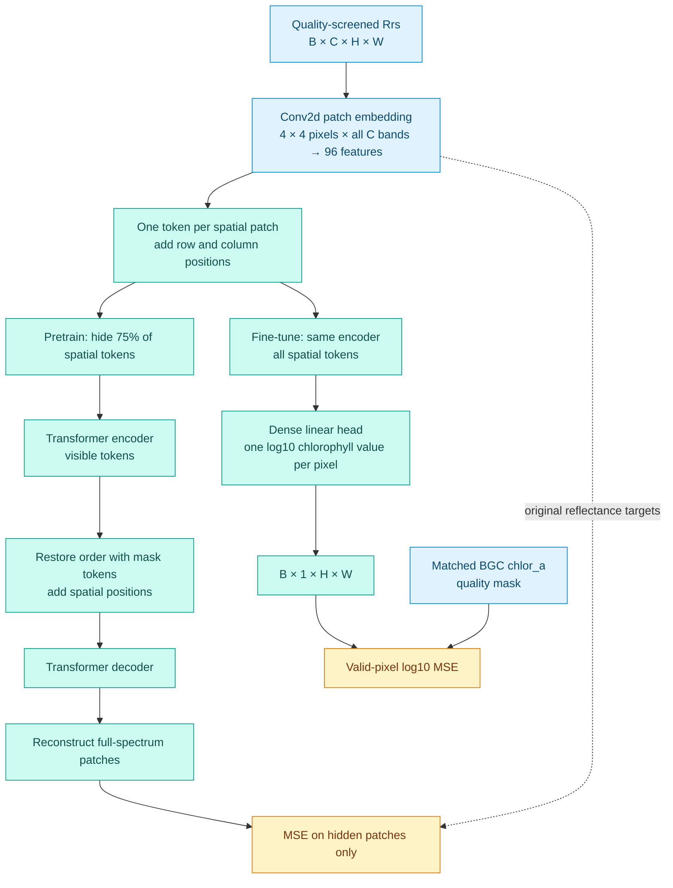

# Architecture


The new baseline places the **full spectrum in each spatial token**. It follows
the spatial/spectral masked-autoencoder design, with OETHER as a reference.
All implementation files belong to this repository.

### Inputs and outputs

`B` is batch size, `C` is the selected band count, and `H`/`W` are chip height
and width. The new spatial model uses **BCHW** order. Height and width must be
multiples of 4 for the default patch size.

| Item | Tensor shape and type | Meaning |
| --- | --- | --- |
| Model input `chips` | `float32 [B, C, H, W]` | Finite, quality-screened Rrs, decoded from packed integers and normalized with training-set mean and standard deviation |
| Model input `wavelengths_nm` | `float32 [C]` | Selected `wavelength_3d` values in strictly increasing order; must match the model's fixed grid |
| Supervised target `chlor_a` | `float32 [B, 1, H, W]` | Matched BGC chlorophyll-a concentration in mg m⁻³, before taking log10 |
| Target mask `valid` | `bool [B, 1, H, W]` | Pixels with valid, positive chlorophyll and acceptable quality flags; used for loss and scoring |
| Pretraining `prediction` | `float32 [B, N, 16 × C]` | Reconstructed patches in normalized reflectance space; `N = (H/4) × (W/4)` |
| Pretraining `hidden_mask` | `bool [B, N]` | `True` means the whole spatial patch was hidden |
| Pretraining `targets` | `float32 [B, N, 16 × C]` | Original normalized patches, used to compute hidden-patch reconstruction loss |
| `mae.reconstruct(...)` output | `float32 [B, C, H, W]` | Patch predictions rearranged into image order; still normalized reflectance |
| Chlorophyll predictor output | `float32 [B, 1, H, W]` | Predicted log10 chlorophyll-a concentration; convert with `10 ** output` to mg m⁻³ |

For example, with `B=2`, `C=172`, and `H=W=128`:

```text
Reflectance input                         [2, 172, 128, 128]
Wavelength list                           [172]
             |
             v
4 × 4 × 172 values → 96 features           [2, 1024, 96]
             |
       +-----+-------------------------------------+
       |                                           |
PRETRAINING                                  CHLOROPHYLL PREDICTION
Keep 256 visible spatial tokens              Use all 1024 spatial tokens
       |                                           |
Encoder → decoder → reconstruction head      Encoder → dense prediction head
       |                                           |
Patch predictions: [2, 1024, 2752]            Log10 chlorophyll: [2, 1, 128, 128]
Hidden mask:       [2, 1024]                         |
       |                                     10 ** prediction
Rearrange:         [2, 172, 128, 128]                |
Undo normalization to recover Rrs in sr⁻¹     Chlorophyll in mg m⁻³
```

The 172-band count is an example, not a fixed PACE property. The benchmark
selects actual native bands between 400 and 700 nm. Chlorophyll targets and
their masks are needed for supervised training and evaluation, not inference.
`Rrs_unc`, location, and quality flags support data preparation or experiments;
they are not extra channels passed into this predictor. The current output is
a point estimate, without a predictive uncertainty map.

### Training paths



| Design | Token content | Tokens for 128 × 128 pixels, C=172 | Spectral grid |
| --- | --- | ---: | --- |
| Original `WavelengthAwareMAE` | 4 × 4 pixels at one wavelength | 176,128 | Physical wavelength position; variable band count |
| New `SpatialSpectralMAE` | 4 × 4 pixels at all wavelengths | 1,024 | Fixed channel meanings; exact wavelength-grid check |

The new projection mixes wavelengths immediately. With 172 bands it compresses
2752 values into 96 features per token. The 172-fold token reduction makes large
chips more practical, but this compression is a bottleneck. A separate width
ablation tests 192 features. Actual PACE band counts come from the file and
selected wavelength range, rather than assuming C=172.

The default model has 4 encoder blocks, 2 decoder blocks and 4 attention heads.
The small supervised benchmark uses 2 encoder blocks and 1 decoder block.
Both use 75% masking, but the new model hides whole spatial patches. The
original wavelength-token model also supports a mixed objective that hides
contiguous spectral bands and entire spatial patches before filling the rest
of its mask at random. It retains explicit wavelength structure for this task.

### Model example

```python
import torch
from src.spatial_model import SpatialSpectralMAE
from src.chlorophyll import ChlorophyllRegressor

# Shape example. For real inputs, read wavelength_3d from the AOP file.
wavelengths_nm = torch.tensor([443., 550., 665.])
chips = torch.rand(2, 3, 8, 8)  # batch, wavelength, height, width
mae = SpatialSpectralMAE(wavelengths_nm)
prediction, hidden_mask, targets = mae(chips, wavelengths_nm)
loss = mae.masked_loss(prediction, hidden_mask, targets)
loss.backward()

predictor = ChlorophyllRegressor(mae)
log10_chlorophyll = predictor(chips, wavelengths_nm)  # [2, 1, 8, 8]
chlorophyll_mg_m3 = 10 ** log10_chlorophyll

# Undo the training normalization after reconstructing reflectance:
# reconstructed_rrs = mae.reconstruct(chips, wavelengths_nm) * train_std + train_mean
```

Use `sensor_band_parameters/wavelength_3d` for Rrs. Keep wavelength order paired
with the data. The spatial model checks its grid but does not embed wavelengths
or handle shifted grids automatically. Its convolution weights give each input
channel a fixed meaning. Cross-sensor transfer still needs spectral alignment
and tests of response width, calibration and reflectance differences.

The [chlorophyll benchmark](chlorophyll_benchmark.md) trains a dense head
against valid, matched BGC targets. It compares the exact same spatial model
with and without reconstruction pretraining. The output is a point estimate
of log10 satellite-derived chlorophyll, not independent phytoplankton truth.
No probabilistic optical inversion or uncertainty-calibrated retrieval is
implemented. [The paper assessment](experiment_design.md) explains why
reconstruction alone cannot resolve the physical ambiguity.

The [original reconstruction pilot](experiment_design.md) and
[wavelength transfer notes](wavelength_transfer.md) remain available.
No pretrained model weights are shipped.
