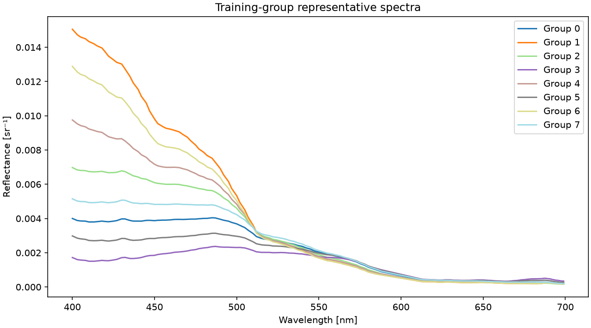
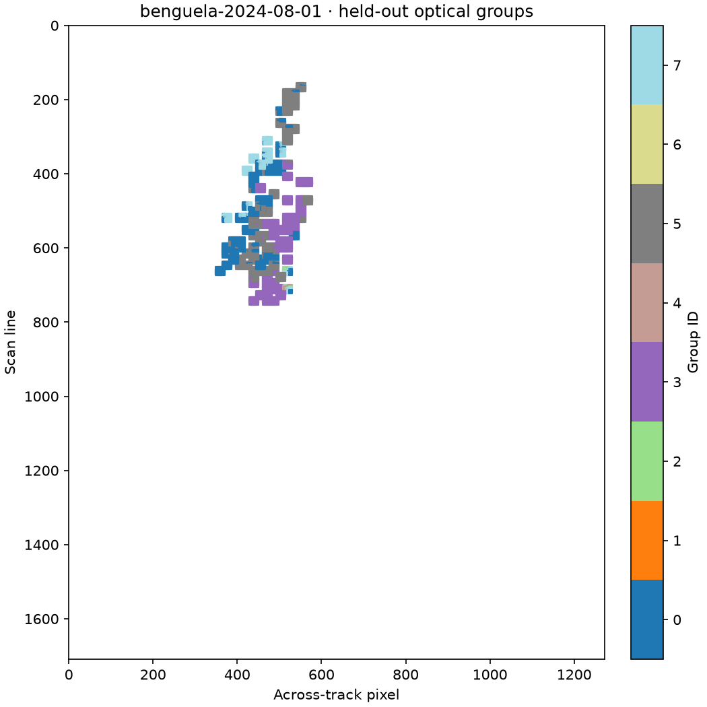

# Thirty-scene AOP discovery results

Completed on 2026-11-20. All ten planned experiments and 45 pairwise comparisons
finished on Nautilus.

**PCA reconstructed missing wavelengths best. Nearby-pixel interpolation filled
spatial holes best. The mixed-mask MAE improved over random masking, but did not
beat the strongest simple controls.**

## Data and training

We downloaded 30 distinct PACE OCI L2 AOP v3.2 granules directly from NASA on
Nautilus. Training used all 136 native visible reflectance bands. No biological
or BGC label was used for training, data selection, or model selection.

| Split | Regions | Month in 2024 | Granules | Clear 16 × 16 chips |
| --- | --- | --- | ---: | ---: |
| Training | California, North Pacific, North Atlantic | June | 18 | 2206 |
| Validation | East Atlantic, South Indian Ocean | July | 6 | 657 |
| Test | Benguela region, South Pacific | August | 6 | 768 |

Dates and geographic boxes are separate across splits. Selection used fixed
regions and date windows, then a minimum of 16 clear, finite chips per granule.
One validation scene supplied only 17 chips. Scoring gives each scene equal
weight. Clear-water selection and the small number of regions limit the study.

The raw files total 9.1 GiB. The exact selected samples occupy about 516 MiB
after compression. Preparation checked file hashes and a complete save/load
round trip. Each worker checked the prepared-file hashes before training.
The [protocol](discovery_multiscene_run.md), [raw scene manifest](../experiments/discovery-scenes-v1.json),
and [prepared manifest](../experiments/discovery-prepared-scenes-v1.json) record the inputs.

The spectral autoencoder, mixed-mask MAE, and random-mask MAE each ran at seeds
0, 1, and 2. Every neural run completed 1000 updates; validation selected its
checkpoint. PCA was fitted once. Validation selected rank 8 from 4, 8, 16, and 32.
Model sizes and losses stayed the same as in the single-scene pilot.

## Held-out reconstruction

Values are mean scene RMSE in sr⁻¹. Lower is better. Neural rows are means over
three seeds. The task average gives equal weight to spectral gaps and spatial
holes. The ± value is the sample standard deviation across seeds, not a
confidence interval. PCA and the controls have one fit on this corpus.

| Method | Missing spectral interval | Full-spectrum spatial hole | Task average |
| --- | ---: | ---: | ---: |
| Training mean | 0.00112742 | 0.00155499 | 0.00134121 |
| Visible-data interpolation | 0.00049462 | **0.00020097** | **0.00034779** |
| PCA, rank 8 | **0.00025961** | 0.00155499 | 0.00090730 |
| Spectral autoencoder | 0.00042594 | 0.00155966 | 0.00099280 ± 0.00003287 |
| MAE, random mask | 0.00090693 | 0.00056273 | 0.00073483 ± 0.00005020 |
| MAE, mixed mask | 0.00057742 | 0.00050900 | 0.00054321 ± 0.00005248 |

Mixed masking reduced the MAE's task-average error by 26.1% relative to random
masking. Its average was also 40.1% below PCA. That comparison includes spatial
holes, where PCA has no spatial context and falls back to the training mean.
Interpolation is stronger on that task. PCA is stronger on the spectral task.

### Weak red signals need attention

The 670–690 nm window matters to the proposed phytoplankton-pattern study.
These are reconstruction errors within that window during the spectral-gap test:

| Method | Window RMSE, sr⁻¹ |
| --- | ---: |
| PCA | **0.00004338** |
| Visible-data interpolation | 0.00005317 |
| Training mean | 0.00015122 |
| Spectral autoencoder | 0.00020418 |
| MAE, mixed mask | 0.00034050 |
| MAE, random mask | 0.00044898 |

The mixed MAE's error here is about 7.9 times PCA's and exceeds the training-mean
control. This calls for a red-band fidelity check before scaling. Reconstruction
error alone does not show whether the encoder or decoder causes the loss.

## Frozen features and optical groups

We fixed eight analysis groups before evaluation. Group numbers and colors are
specific to each run. The groups describe differences in observed spectral
brightness and shape; biological interpretation needs independent observations.

| Representation | Group agreement after added noise | Neighbor overlap after noise, at 5 | Group agreement across seeds, adjusted Rand index |
| --- | ---: | ---: | ---: |
| PCA | 91.0% | 45.0% | — |
| Spectral autoencoder | 90.9% | 28.2% | 0.709 |
| MAE, random mask | 96.3% | 81.5% | 0.393 |
| MAE, mixed mask | 96.3% | 79.3% | 0.643 |
| Untrained MAE | 94.6% | 80.0% | — |

The adjusted Rand index accounts for arbitrary group numbers and chance
agreement; 1 means identical partitions. Mixed masking gives more repeatable
groups than random masking. The spectral autoencoder has the highest group
agreement across seeds in this study.

Noise tests add reported-uncertainty-scaled Gaussian noise with assumed spectral
correlation 0.8. This is not measured OCI error covariance. The untrained MAE
already has high noise stability. Mixed-mask training does not improve its
neighbor stability in this check, so reconstruction gains alone do not establish
a discovery advantage.

The mixed MAE's five-neighbor overlap across seeds is 54.9%, compared with 39.0%
for random masking and 52.7% for the spectral autoencoder. Retrieval queries use
test scenes and a fixed training-scene bank, so adjacent test pixels cannot serve
as answers. The bank contains at most 128 patches per training scene.

The illustrations use seed 0. These curves are means of **observed training
spectra grouped by encoder features**, not reconstructed spectra:

The first Benguela test window used an acquisition from 2024-08-03. Each colored
location below is a selected 2 × 2 native-pixel patch. Blank areas are unselected
or screened out. Axes show scan/pixel coordinates.

## Decision and limits

Keep PCA and interpolation as strong controls. Before increasing model size,
test one change for red-band fidelity using AOP validation data. Freeze the
encoder and analysis choices before checking independent field associations.
Biological labels remain outside training and model selection.

This is a short exploratory study with six test granules from two regions.
Date and region both change across splits. Other limits include the small
retrieval bank, incomplete geometry/cloud-edge audits, untested spatial offsets,
mixed GPU hardware, and dependencies that are not fully locked. No independent
pigment, microscopy, or field-optics matchups were evaluated. Group IDs do not
identify phytoplankton species or calibrated concentrations.

Checks: 22 unit tests passed; one Jupyter execution test was skipped because
the local sandbox blocks kernel ports. All ten real experiments completed.
The comparison verified matching raw and prepared hashes, splits, patch
coordinates, and retrieval samples. The copied report archive was checksum-verified.

[Machine-readable results](discovery_multiscene_results.json) include individual
runs and all 45 pairwise comparisons. Local reports and plots are under
`outputs/discovery-v1/`. Full checkpoints, feature arrays, and reports remain on
PVC `pace-experiment-results` under `/results/discovery-v1/`; raw inputs remain
under `/results/data/discovery-v2/`. Source bundles are under `/results/code/`.
